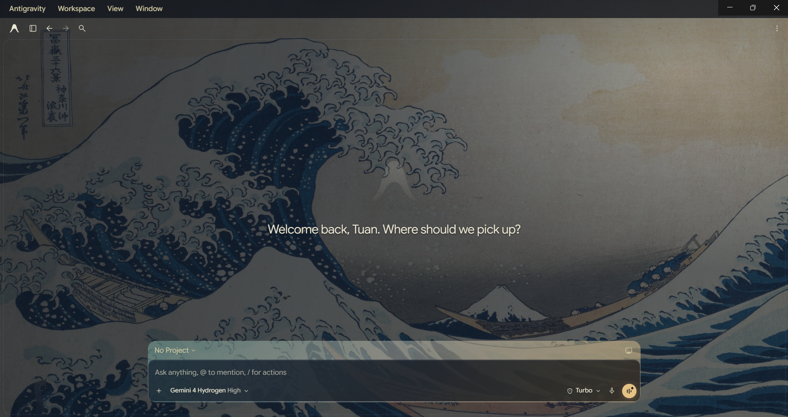
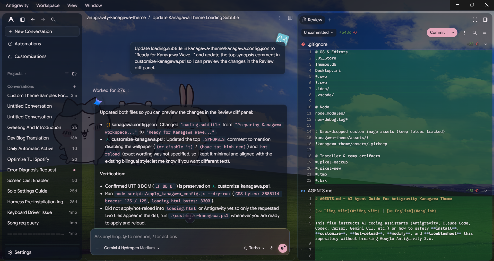
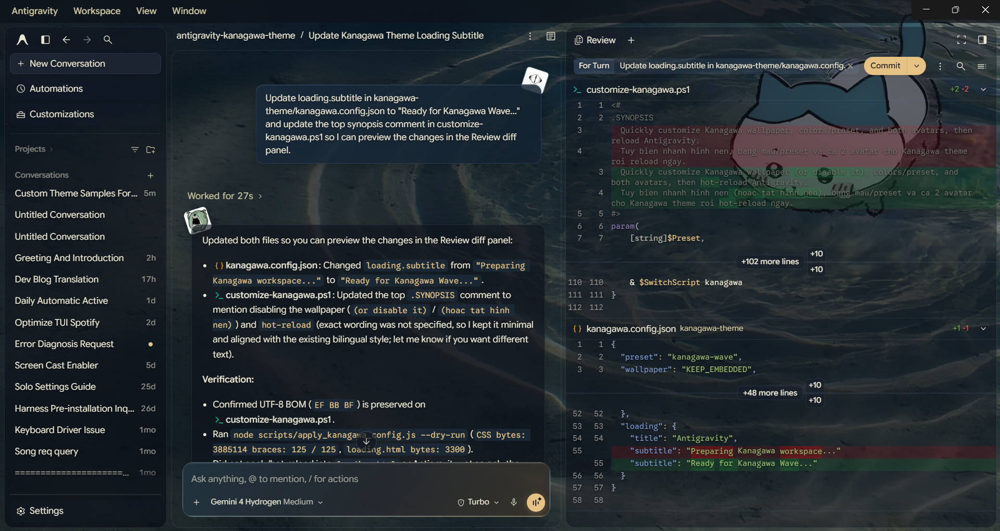

# Kanagawa Theme for Google Antigravity 2.x

[🇻🇳 Tiếng Việt](#tiếng-việt) | [🇺🇸 English](#english)

### Preview / Xem trước


*Kanagawa Wave default wallpaper & aqua-to-gold gradient composer / Hình nền Kanagawa mặc định & khung nhập gradient xanh ↔ vàng.*

| Custom Wallpaper + Review Panel | Custom Avatars + Diff View |
| :---: | :---: |
|  |  |
| *Custom wallpaper, 3-column translucent layout & file review* | *Custom user/agent avatars & translucent red/green code diff* |

---

<a name="tiếng-việt"></a>
## 🇻🇳 Tiếng Việt

Theme **Kanagawa Wave (Tối)** & **Kanagawa Lotus (Sáng)** cho **Google Antigravity 2.x** trên Windows — nền ảnh sắc nét không blur, các khung panel bo tròn trong suốt vừa đủ, màn hình loading phong cách Kanagawa, khung chat gradient xanh ↔ vàng và bộ công cụ cho phép người dùng tự đổi **hình nền**, **màu theme / preset** và **cả 2 avatar** chỉ trong vài giây.

### Yêu cầu

- **Windows** đã cài **Google Antigravity 2.x** (`%LOCALAPPDATA%\Programs\Antigravity`)
- **Node.js** (để script chạy `@electron/asar` giải nén/đóng gói `app.asar` và xử lý ảnh/màu)

### Cài đặt

1. Tải repo về máy:
   ```powershell
   git clone https://github.com/kienvts123-collab/Antigravity-Theme.git
   cd Antigravity-Theme
   ```
2. Đóng hoàn toàn Antigravity (hoặc mở **PowerShell ở ngoài**, không chạy trong terminal bên trong Antigravity, rồi dùng cờ `-KillRunning`):
   ```powershell
   .\install.ps1 -KillRunning
   ```
   *(Hoặc đóng Antigravity hoàn toàn rồi click đúp `install.bat`.)*
3. Mở lại Antigravity để dùng theme và màn hình loading mới.

> **Lưu ý:** Khi Antigravity tự cập nhật phiên bản mới, file `app.asar` sẽ trở về bản gốc. Bạn chỉ cần chạy lại `.\install.ps1 -KillRunning` là theme hoạt động lại bình thường.

### Tùy biến dễ dàng với Theme Studio (`Ctrl+Alt+K`) & CLI

Theme nay có **In-App Theme Studio** chạy trực tiếp bên trong Antigravity — chỉnh slider xem trước **60fps** ngay lập tức và lưu **không cần reload lại cửa sổ**:

- **Mở Theme Studio:** Nhấn **`Ctrl+Alt+K`** hoặc click nút nổi **`🎨 Theme Studio`** ở góc dưới phải (có thể ẩn nút nổi trong tab *Nâng cao* nếu thích tối giản).
- **5 tab tùy chỉnh toàn diện:**
  1. **Hồ sơ (Profiles):** Chuyển 1 click giữa 9+ combo có sẵn (*My Current Setup*, *Frosted Glass*, *Minimal Clean*, *Tokyo Night*, *Nordic Frost*, *Kanagawa Wave/Dragon*, *Sakura Dusk*, *Midnight Aqua*) — các hồ sơ preset tự động **giữ nguyên hình nền & avatar hiện tại của bạn** (riêng *Minimal Clean* tắt hình nền); hỗ trợ lưu/cập nhật/export-import combo của riêng bạn.
  2. **Hình nền (Wallpaper):** Hỗ trợ **`.avif`**, `.png`, `.jpg`, `.jpeg`, `.webp`, `.svg`, `.gif`, `.bmp`; kéo-thả ảnh trực tiếp hoặc chọn file; thư viện ảnh dùng lại nhanh; hình nền **riêng cho Dark / Light mode**; chỉnh **Blur, Brightness, Contrast, Saturation, Opacity, Scale**, **Scrim overlay** (`directional` / `solid` / `vignette` / `gradient` / `none`), **Fit** (`cover` / `contain` / `auto` / `100% 100%`) & lưới 9 vị trí.
  3. **Bề mặt & Kính mờ (Surfaces & Glass):** Slider chỉnh độ trong suốt riêng từng vùng (**Sidebar**, **Panel phụ / Agent**, **Nền vùng Chat**, **Tin nhắn User**, **Khung Composer**, **Code block**, **Monaco Editor / Terminal**, **Menu/Modal nổi**, **Titlebar**), **Kính mờ (`backdrop-filter blur` & `saturate`)** và bo góc (`radius`) từng thành phần.
  4. **Màu & Avatar:** Đổi nhanh bảng màu 6 preset, color picker đầy đủ cho Dark & Light mode, chỉnh **cỡ / bo góc (`0%–50%`) / góc xoay (kể cả `0°`) / bật-tắt từng avatar** và gradient viền + nền Composer / User bubble.
  5. **Nâng cao (Typography, Loading & Custom CSS):** Chọn font UI & font Code, cỡ chữ chat/code, `line-height`, tùy chỉnh màn hình Loading (`Kanagawa Wave` / `Minimal` / `Terminal`, chữ chính/phụ, hiện/ẩn vòng xoay & thanh tiến trình) và trình soạn `kanagawa-theme/custom.css` lưu bền vững qua mọi lần rebuild.

**Tùy biến qua PowerShell / Menu nhanh:**
- **Menu tương tác / File picker:** Click đúp **`customize-kanagawa.bat`** hoặc chạy:
  ```powershell
  .\customize-kanagawa.ps1 -Menu

  # Hoặc chọn thẳng từng file ảnh qua hộp thoại Windows Explorer (hỗ trợ cả .avif):
  .\customize-kanagawa.ps1 -PickWallpaper
  .\customize-kanagawa.ps1 -PickWallpaperLight
  .\customize-kanagawa.ps1 -PickUserAvatar
  .\customize-kanagawa.ps1 -PickAgentAvatar
  ```
- **Dùng tham số CLI & Profile:**
  ```powershell
  # Chuyển nhanh Profile combo hoặc Preset bảng màu
  .\customize-kanagawa.ps1 -Profile frosted-glass
  .\customize-kanagawa.ps1 -Preset tokyo-night

  # Đổi hình nền .avif + bật kính mờ + scrim + màn hình loading Terminal + lưu profile mới
  .\customize-kanagawa.ps1 -Wallpaper "D:\Pictures\bg.avif" -GlassBlur 14 -PanelOpacity 36 -ScrimStyle gradient -LoadingStyle terminal -SaveProfile "My Glass"

  # Chỉnh avatar riêng từng bên (size/bo góc/xoay/hiện-ẩn), hoặc tắt hình nền
  .\customize-kanagawa.ps1 -AvatarRadius 50 -AvatarRotate 0 -UserAvatarSize 40 -AgentAvatarVisible "false"
  .\customize-kanagawa.ps1 -NoWallpaper
  # Xem tất cả tham số CLI:
  .\customize-kanagawa.ps1 -Help
  ```
- **Sửa file cấu hình / Custom CSS:** Chỉnh `kanagawa-theme/kanagawa.config.json` hoặc `kanagawa-theme/custom.css`, rồi chạy `.\customize-kanagawa.ps1` (hoặc `.\switch-theme.ps1` nếu chỉ sửa `custom.css`).

Mỗi lần tùy biến sẽ cập nhật `kanagawa-theme/kanagawa.css`, `kanagawa-theme/loading.html`, đồng bộ sang Antigravity và hot-swap CSS tức thì qua `fs.watch` (**không reload toàn bộ cửa sổ, không đóng gói lại `app.asar`**). Mọi thay đổi từ Studio cũng tự đồng bộ ngược về thư mục repo nhờ `repo-link.json`.

### Reload & Gỡ cài đặt

- **Đồng bộ & reload thủ công:** `.\switch-theme.ps1` (hoặc click đúp `switch-theme.bat`)
- **Gỡ theme & khôi phục Antigravity gốc:**
  ```powershell
  .\uninstall.ps1 -KillRunning
  ```

---

<a name="english"></a>
## 🇺🇸 English

A crisp, unblurred **Kanagawa Wave (Dark)** & **Kanagawa Lotus (Light)** theme for **Google Antigravity 2.x** on Windows — featuring rounded translucent panes, a Kanagawa wave startup loading screen, aqua-to-gold composer gradient, and a built-in customizer to swap your **wallpaper**, **color palette / presets**, and **both chat avatars** in seconds.

### Requirements

- **Windows** with **Google Antigravity 2.x** installed (`%LOCALAPPDATA%\Programs\Antigravity`)
- **Node.js** (used for `@electron/asar` extraction/repacking and image/color customization)

### Installation

1. Clone this repository:
   ```powershell
   git clone https://github.com/kienvts123-collab/Antigravity-Theme.git
   cd Antigravity-Theme
   ```
2. Close Antigravity completely (or run from an **external PowerShell** window with `-KillRunning`):
   ```powershell
   .\install.ps1 -KillRunning
   ```
   *(Or close Antigravity completely and double-click `install.bat`.)*
3. Launch Antigravity.

> **Note:** Antigravity auto-updates overwrite `app.asar` with the stock bundle. Simply re-run `.\install.ps1 -KillRunning` after an update to restore the theme.

### Easy Customization with Theme Studio (`Ctrl+Alt+K`) & CLI

This theme includes a **live In-App Theme Studio** inside Antigravity — scrub sliders at **60fps** and apply changes with **zero window reloads**:

- **Open Theme Studio:** Press **`Ctrl+Alt+K`** or click the floating **`🎨 Theme Studio`** pill in the bottom-right corner.
- **5 Customization Tabs:**
  1. **Profiles:** 1-click switching across 9+ full combos (*My Current Setup*, *Frosted Glass*, *Minimal Clean*, *Tokyo Night*, *Nordic Frost*, etc.) — built-in preset profiles automatically **preserve your current wallpaper & avatars** (while *Minimal Clean* disables wallpaper cleanly) — plus save, update, and JSON clipboard export/import.
  2. **Wallpaper:** Full **`.avif`**, `.png`, `.jpg`, `.jpeg`, `.webp`, `.svg`, `.gif`, `.bmp` support; native file picker or drag-and-drop; reusable asset library; separate **Dark & Light wallpapers**; **Blur, Brightness, Contrast, Saturation, Opacity, Scale** sliders; **Scrim overlay** (`directional` / `solid` / `vignette` / `gradient` / `none`), **Fit**, & 9-point position grid.
  3. **Surfaces & Glassmorphism:** Per-region opacity sliders (**Sidebar**, **Side Panel**, **Chat Canvas**, **User Bubble**, **Composer**, **Code Blocks**, **Monaco Editor / Terminal**, **Modals/Menus**, **Titlebar**), backdrop blur & saturation, and corner radii.
  4. **Colors & Avatars:** 6 quick palette presets, full Dark & Light color pickers, avatar **size, corner radius (`0%–50%`), rotation angle (including `0°`), individual show/hide toggles**, plus Composer & User Bubble gradient pickers.
  5. **Advanced:** UI/Code font families & sizes, line-height, loading screen style (`kanagawa-wave` / `minimal` / `terminal`)/text/toggles, and persistent `kanagawa-theme/custom.css` editor.

**PowerShell Menu & CLI:**
- **Interactive Menu / Explorer Pickers:** Double-click **`customize-kanagawa.bat`** or run:
  ```powershell
  .\customize-kanagawa.ps1 -Menu
  .\customize-kanagawa.ps1 -PickWallpaper
  .\customize-kanagawa.ps1 -PickWallpaperLight
  ```
- **CLI Profiles, Presets & Options:**
  ```powershell
  .\customize-kanagawa.ps1 -Profile frosted-glass
  .\customize-kanagawa.ps1 -Wallpaper "D:\Pictures\bg.avif" -GlassBlur 14 -PanelOpacity 36 -ScrimStyle gradient -LoadingStyle terminal -SaveProfile "My Glass"
  .\customize-kanagawa.ps1 -AvatarRadius 50 -AvatarRotate 0 -UserAvatarSize 40 -AgentAvatarVisible "false"
  .\customize-kanagawa.ps1 -NoWallpaper
  # List all CLI parameters:
  .\customize-kanagawa.ps1 -Help
  ```

Changes update `kanagawa-theme/kanagawa.css` & `kanagawa-theme/loading.html`, sync cleanly to Antigravity, and hot-swap CSS via `fs.watch` without reloading the window (**no `app.asar` repack needed**). Edits made in Studio also mirror back to your repo folder via `repo-link.json`.

### Reload & Uninstall

- **Manual sync & hot-reload:** `.\switch-theme.ps1` (or double-click `switch-theme.bat`)
- **Uninstall & restore stock Antigravity:**
  ```powershell
  .\uninstall.ps1 -KillRunning
  ```

---

## Credits / Nguồn tham khảo

- Theme injector, Chrome DevTools hot-reload workflow, and `app.asar` patcher architecture derived from [AreSet01/antigravity-theme](https://github.com/AreSet01/antigravity-theme) (MIT License).
- Kanagawa color palette inspired by [rebelot/kanagawa.nvim](https://github.com/rebelot/kanagawa.nvim).
