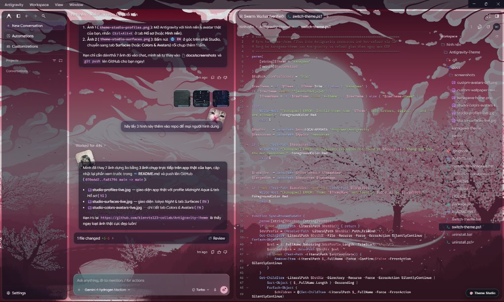
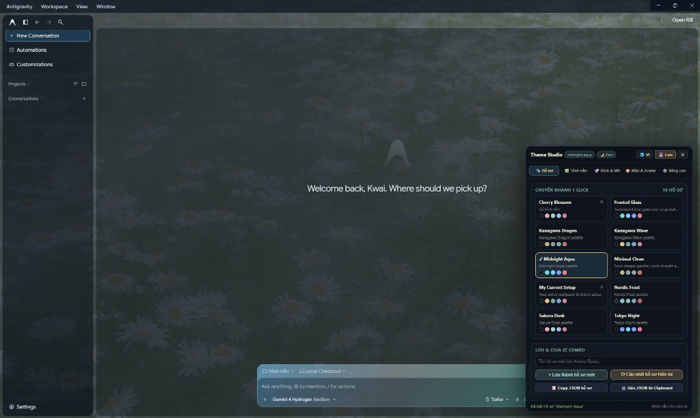
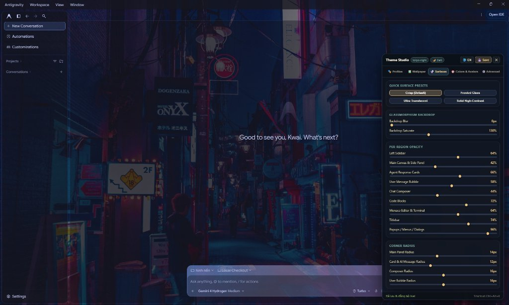
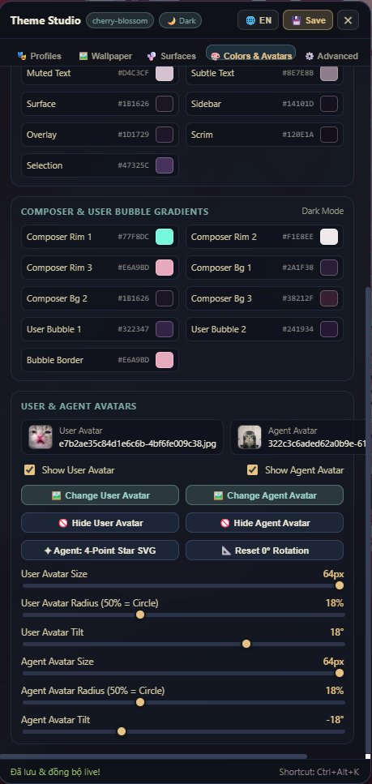

# Kanagawa Theme & Live Studio for Google Antigravity 2.x

[🇻🇳 Tiếng Việt](#-tiếng-việt) | [🇺🇸 English](#-english)

---

### Preview / Xem trước

| Full 3-Column Workspace & Custom Avatars | Theme Studio — Profiles (`🇻🇳 VI`) |
| :---: | :---: |
|  |  |
| *Giao diện 3 cột trong suốt: Chat + Avatar tùy chỉnh + Monaco Editor & nút nổi `Theme Studio`* | *Chuyển hồ sơ 1-click (`Midnight Aqua`) & đổi ngôn ngữ VI/EN ngay trên app thật* |

| Theme Studio — Surfaces & Glass (`🇺🇸 EN`) | Colors, Gradients & Avatars (`Ctrl+Alt+K`) |
| :---: | :---: |
|  |  |
| *Chế độ `Tokyo Night` + thanh trượt kính mờ & độ trong suốt từng vùng (`EN`)* | *Chỉnh bảng màu, gradient & kích thước/bo góc/góc nghiêng avatar trực tiếp* |

| Kanagawa Home & Composer | Custom Avatars + Diff View |
| :---: | :---: |
|  |  |
| *Kanagawa Wave & gradient composer* | *Custom user/agent avatars & code diff* |

---

## 🇻🇳 Tiếng Việt

Bộ giao diện **Kanagawa Wave (Tối)**, **Kanagawa Lotus (Sáng)** & **In-App Theme Studio (`Ctrl+Alt+K`)** cho **Google Antigravity 2.x** trên Windows — hỗ trợ tùy chỉnh trực tiếp **60fps không cần reload cửa sổ**, **song ngữ Tiếng Việt / English (`🌐 VI / EN`)**, **hình nền `.avif`**, **kính mờ (`backdrop-filter`)**, **9+ hồ sơ 1-click**, **avatar User/Agent tùy biến**, **màn hình loading**, và **trình sửa `custom.css`**.

### 1. Yêu cầu hệ thống

- **Windows 10/11** đã cài **Google Antigravity 2.x** (`%LOCALAPPDATA%\Programs\Antigravity`)
- **Node.js** (dùng để chạy `@electron/asar` giải nén/đóng gói `app.asar` và xử lý cấu hình) — tải tại [nodejs.org](https://nodejs.org/)

### 2. Cài đặt (2 cách)

#### Cách A — Tải ZIP (Không cần cài Git)
1. Bấm nút **Code → Download ZIP** trên GitHub và **giải nén** vào một thư mục cố định (ví dụ `C:\Tools\Antigravity-Theme` — không chạy trực tiếp bên trong cửa sổ xem trước `.zip`).
2. **Đóng hoàn toàn Antigravity** (nhớ kiểm tra cả icon ở khay hệ thống / System Tray).
3. Click đúp **`install.bat`** (tự bỏ qua chặn ExecutionPolicy của PowerShell).
4. Mở lại Antigravity và bấm **`Ctrl+Alt+K`** (hoặc bấm nút **`🎨 Theme Studio`** ở góc dưới phải).

#### Cách B — Dùng Git & PowerShell
Mở PowerShell **bên ngoài Antigravity** (không chạy trong terminal bên trong Antigravity nếu dùng `-KillRunning`):
```powershell
git clone https://github.com/KwaiPowie/Antigravity-Theme.git
cd Antigravity-Theme
.\install.ps1 -KillRunning
```

> **Lưu ý khi Antigravity tự cập nhật:** Khi Antigravity update lên bản mới, file `app.asar` sẽ quay về bản gốc. Bạn chỉ cần chạy lại `install.bat` (hoặc `.\install.ps1 -KillRunning`) — toàn bộ cấu hình, ảnh nền và hồ sơ của bạn vẫn được giữ nguyên.

---

### 3. Sử dụng Theme Studio (`Ctrl+Alt+K`)

Nhấn **`Ctrl+Alt+K`** hoặc click nút nổi **`🎨 Theme Studio`** để mở bảng tùy chỉnh trực tiếp trong Antigravity:

- **Đổi ngôn ngữ `🌐 VI` / `🌐 EN`:** Bấm nút **`🌐 VI`** / **`🌐 EN`** ngay góc trên bên phải của Theme Studio (hoặc chọn trong tab *Nâng cao / Advanced*) để chuyển giao diện giữa Tiếng Việt và English tức thì.
- **5 Tab tùy chỉnh toàn diện:**
  1. **🎭 Hồ sơ (Profiles):** Chuyển 1-click giữa các combo (*Kanagawa Wave*, *Kanagawa Dragon*, *Sakura Dusk*, *Midnight Aqua*, *Tokyo Night*, *Nordic Frost*, *Frosted Glass*, *Minimal Clean*, *My Current Setup*...), lưu combo mới, cập nhật hoặc **Copy / Dán JSON** để chia sẻ.
  2. **🖼️ Hình nền (Wallpaper):** Kéo-thả hoặc chọn ảnh (`.avif`, `.png`, `.jpg`, `.webp`, `.svg`, `.gif`, `.bmp` ≤ 15MB); chọn ảnh **riêng cho Dark & Light mode**; thư viện ảnh dùng lại nhanh; chỉnh **Blur, Brightness, Contrast, Saturate, Opacity, Scale**, **Scrim overlay** (`directional` / `gradient` / `solid` / `vignette` / `none`), **Fit**, và lưới **9 vị trí**.
  3. **🫧 Kính & Mờ (Surfaces & Glass):** Preset bề mặt nhanh + thanh trượt chỉnh độ mờ đục từng vùng (**Sidebar**, **Khung nền chính & Side Panel**, **Tin nhắn AI**, **Bong bóng User**, **Composer**, **Code Block**, **Monaco Editor / Terminal**, **Titlebar**, **Popup/Menu**), **Glass Blur / Saturate**, và **bo góc (`Border Radius`)**.
  4. **🎨 Màu & Avatar:** Chọn nhanh 6 bảng màu preset, color picker đầy đủ cho Dark & Light, chỉnh gradient viền/nền **Composer** & **User Bubble**, bật/tắt, đổi ảnh, chỉnh **kích thước (`18–64px`), bo góc (`0–50%`), góc xoay (`-45°..45°`)** cho từng avatar hoặc dùng **Sao 4 cánh SVG** đổi màu trực tiếp.
  5. **⚙️ Nâng cao (Advanced):** Đổi **Font UI / Font Code**, cỡ chữ Chat/Code, `line-height`; tùy chỉnh **Màn hình khởi động** (`Kanagawa Wave` / `Minimal` / `Terminal`, chữ chính/phụ, biểu tượng, thanh tiến trình); trình soạn **`custom.css`** bền vững (`Ctrl+S` để áp dụng); đổi **Ngôn ngữ (`VI/EN`)**, vị trí nút nổi, Reload / Reset mặc định.

---

### 4. Công cụ PowerShell & Menu nhanh

- **Menu tương tác / Chọn ảnh nhanh:** Click đúp **`customize-kanagawa.bat`** hoặc chạy:
  ```powershell
  .\customize-kanagawa.ps1 -Menu
  .\customize-kanagawa.ps1 -PickWallpaper
  .\customize-kanagawa.ps1 -PickUserAvatar
  .\customize-kanagawa.ps1 -PickAgentAvatar
  ```
- **Ví dụ CLI:**
  ```powershell
  # Chuyển profile hoặc preset màu
  .\customize-kanagawa.ps1 -Profile frosted-glass
  .\customize-kanagawa.ps1 -Preset tokyo-night

  # Tùy chỉnh nhanh hình nền .avif + kính mờ + màn hình loading Terminal
  .\customize-kanagawa.ps1 -Wallpaper "D:\Pictures\bg.avif" -GlassBlur 14 -PanelOpacity 36 -ScrimStyle gradient -LoadingStyle terminal -SaveProfile "My Glass"

  # Xem toàn bộ tham số CLI
  .\customize-kanagawa.ps1 -Help
  ```
- **Đồng bộ thủ công:** Click đúp `switch-theme.bat` hoặc chạy `.\switch-theme.ps1`.
- **Gỡ cài đặt & khôi phục Antigravity gốc:** Đóng Antigravity rồi click đúp `uninstall.bat` hoặc chạy:
  ```powershell
  .\uninstall.ps1 -KillRunning
  ```

---

### 5. Khắc phục sự cố nhanh

- **Windows chặn chạy script `.ps1`:** Dùng file **`.bat`** (`install.bat`, `customize-kanagawa.bat`, `switch-theme.bat`, `uninstall.bat`) hoặc mở PowerShell chạy `Set-ExecutionPolicy -Scope CurrentUser RemoteSigned`.
- **Không thấy thay đổi sau khi cập nhật repo:** Chạy `.\switch-theme.ps1` (nếu chỉ đổi CSS/Studio) hoặc `.\install.ps1 -KillRunning` ở PowerShell **bên ngoài** Antigravity (nếu có cập nhật `patch\pixelTheme.js`).

---

## 🇺🇸 English

A customizable **Kanagawa Wave (Dark)**, **Kanagawa Lotus (Light)** & **Live In-App Theme Studio (`Ctrl+Alt+K`)** suite for **Google Antigravity 2.x** on Windows — featuring **60fps zero-reload live customization**, **built-in bilingual UI (`🌐 VI / EN`)**, **`.avif` wallpaper support**, **glassmorphism (`backdrop-filter`)**, **9+ 1-click profiles**, **customizable User/Agent avatars**, **startup loading screen styles**, and a persistent **`custom.css`** editor.

### 1. Requirements

- **Windows 10/11** with **Google Antigravity 2.x** installed (`%LOCALAPPDATA%\Programs\Antigravity`)
- **Node.js** (required for `@electron/asar` extraction/repacking and theme compilation) — [nodejs.org](https://nodejs.org/)

### 2. Installation (2 Ways)

#### Option A — Download ZIP (No Git Required)
1. Click **Code → Download ZIP** on GitHub and **extract** it to a permanent folder (e.g. `C:\Tools\Antigravity-Theme` — do not run directly inside the ZIP preview).
2. **Close Antigravity completely** (including the System Tray icon).
3. Double-click **`install.bat`** (automatically runs with `-ExecutionPolicy Bypass`).
4. Reopen Antigravity and press **`Ctrl+Alt+K`** (or click the floating **`🎨 Theme Studio`** pill in the bottom-right corner).

#### Option B — Git & PowerShell
Run from an **external PowerShell** window (not inside Antigravity's integrated terminal if using `-KillRunning`):
```powershell
git clone https://github.com/KwaiPowie/Antigravity-Theme.git
cd Antigravity-Theme
.\install.ps1 -KillRunning
```

> **Note after Antigravity auto-updates:** Antigravity updates overwrite `app.asar` with the stock bundle. Simply re-run `install.bat` (or `.\install.ps1 -KillRunning`) — your config, wallpapers, and profiles stay intact.

---

### 3. Using Theme Studio (`Ctrl+Alt+K`)

Press **`Ctrl+Alt+K`** or click the floating **`🎨 Theme Studio`** button to customize everything live:

- **Switch Language (`🌐 VI` / `🌐 EN`):** Click the **`🌐 VI` / `🌐 EN`** button in the Studio header (or in the *Advanced* tab) to toggle the entire Studio UI between English and Vietnamese instantly.
- **5 Comprehensive Tabs:**
  1. **🎭 Profiles:** 1-click switching across built-in and custom combos (*Kanagawa Wave*, *Kanagawa Dragon*, *Sakura Dusk*, *Midnight Aqua*, *Tokyo Night*, *Nordic Frost*, *Frosted Glass*, *Minimal Clean*, *My Current Setup*...), save/update profiles, and **Copy / Paste JSON** to share setups.
  2. **🖼️ Wallpaper:** Drag-and-drop or browse images (`.avif`, `.png`, `.jpg`, `.webp`, `.svg`, `.gif`, `.bmp` ≤ 15MB); separate **Dark & Light wallpapers**; reusable asset library; **Blur, Brightness, Contrast, Saturation, Opacity, Scale**, **Scrim overlay** (`directional` / `gradient` / `solid` / `vignette` / `none`), **Fit**, & 9-point position grid.
  3. **🫧 Surfaces & Glass:** Quick surface presets + per-region opacity sliders (**Left Sidebar**, **Main Canvas & Side Panel**, **Agent Response Cards**, **User Bubble**, **Chat Composer**, **Code Blocks**, **Monaco Editor & Terminal**, **Titlebar**, **Popups/Menus**), **Backdrop Blur / Saturate**, and **Corner Radius** controls.
  4. **🎨 Colors & Avatars:** 6 quick palette presets, full Dark & Light color pickers, Composer & User Bubble gradient pickers, individual avatar toggles, image pickers, **size (`18–64px`), corner radius (`0–50%`), tilt rotation (`-45°..45°`)**, and live-recolored **4-Point Star SVG** agent avatar.
  5. **⚙️ Advanced:** UI & Code font families, chat/code font sizes, `line-height`; **Startup Loading Screen** style (`kanagawa-wave` / `minimal` / `terminal`), title/subtitle, emblem/progress toggles; persistent **`custom.css`** editor (`Ctrl+S` to apply); **Language (`VI/EN`)**, pill position, Reload / Reset defaults.

---

### 4. PowerShell Menu & CLI

- **Interactive Menu / File Pickers:** Double-click **`customize-kanagawa.bat`** or run:
  ```powershell
  .\customize-kanagawa.ps1 -Menu
  .\customize-kanagawa.ps1 -PickWallpaper
  .\customize-kanagawa.ps1 -PickUserAvatar
  .\customize-kanagawa.ps1 -PickAgentAvatar
  ```
- **CLI Examples:**
  ```powershell
  .\customize-kanagawa.ps1 -Profile frosted-glass
  .\customize-kanagawa.ps1 -Preset tokyo-night
  .\customize-kanagawa.ps1 -Wallpaper "D:\Pictures\bg.avif" -GlassBlur 14 -PanelOpacity 36 -ScrimStyle gradient -LoadingStyle terminal -SaveProfile "My Glass"
  .\customize-kanagawa.ps1 -Help
  ```
- **Manual Sync:** Double-click `switch-theme.bat` or run `.\switch-theme.ps1`.
- **Uninstall & Restore Stock Antigravity:** Close Antigravity and double-click `uninstall.bat` or run:
  ```powershell
  .\uninstall.ps1 -KillRunning
  ```

---

### 5. Troubleshooting

- **PowerShell script execution blocked:** Use the **`.bat`** wrappers (`install.bat`, `customize-kanagawa.bat`, `switch-theme.bat`, `uninstall.bat`) or run `Set-ExecutionPolicy -Scope CurrentUser RemoteSigned`.
- **Updates not appearing after pulling:** Run `.\switch-theme.ps1` for CSS/Studio updates, or `.\install.ps1 -KillRunning` from an **external** PowerShell window when `patch\pixelTheme.js` changes.

---

## Credits / Nguồn tham khảo

- Original Kanagawa theme & `app.asar` patcher architecture from [Tuna285/Antigravity-Theme](https://github.com/Tuna285/Antigravity-Theme) and [AreSet01/antigravity-theme](https://github.com/AreSet01/antigravity-theme) (MIT License).
- Kanagawa color palette inspired by [rebelot/kanagawa.nvim](https://github.com/rebelot/kanagawa.nvim).
